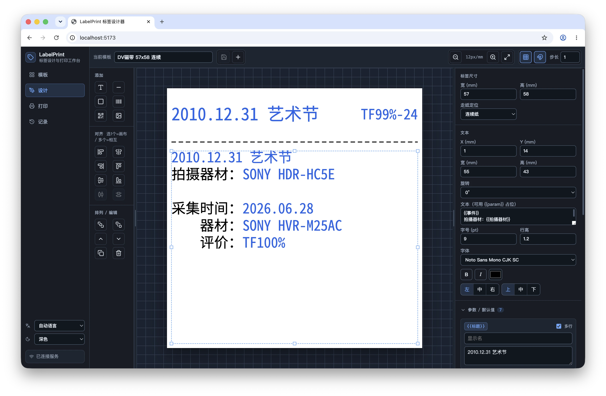

# LabelPrint

[](https://github.com/xingrz/labelprint/actions/workflows/ci.yml)
[](https://github.com/xingrz/labelprint/releases)
[](./LICENSE)



LabelPrint is a self-hosted web app for designing and printing parameterized
thermal labels.

Use it to create millimetre-precise label templates, define placeholders such as
`{{name}}`, fill those placeholders from a form or REST API, preview the rendered
label, and send the job to a configured printer target. It is built for trusted
local networks and does not include authentication by default.

## What It Does

- Visual label template editing with text, lines, boxes, barcodes, QR codes, and
  images.
- Print-time parameters with defaults, so one template can produce many labels.
- Server-rendered previews that match the print pipeline.
- Printer target management from the web UI.
- Print history with quick reprint.
- Built-in PDF download, browser print, TSPL download, Web Bluetooth TSPL, and
  WebUSB TSPL targets.
- Server-side delivery through USB device paths, CUPS raw queues, or network
  sockets.

The bundled server-side hardware backend currently generates TSPL bitmap jobs.
The print pipeline is protocol-oriented, so other output backends can be added
without changing how users design templates.

## Quick Start (Docker)

Prebuilt multi-arch images (amd64/arm64) are published to GitHub Container
Registry on every release:

```yaml
# compose.yml
services:
  labelprint:
    image: ghcr.io/xingrz/labelprint:latest
    restart: unless-stopped
    ports:
      - 5179:5179
    volumes:
      - ./data:/data
```

```bash
docker compose up -d
```

Open:

```text
http://<host>:5179
```

## Quick Start (from source)

Requirements:

- Node.js 20 or newer
- npm

```bash
npm install
npm run build
npm start
```

Open:

```text
http://localhost:5179
```

## Basic Workflow

1. Create or open a template.
2. Set the label size and feed-positioning mode.
3. Add elements and placeholders.
4. Open the Print page and fill the generated form.
5. Select a target such as PDF download, browser print, TSPL download, Web
   Bluetooth TSPL, WebUSB TSPL, CUPS, USB, or network socket.
6. Print. For server-side targets, open the `CLI` dialog to copy an equivalent
   `curl` command.

Main screens are addressable with hash routes such as `#/templates`,
`#/design/<template-id>`, `#/print/<template-id>`, and `#/history`.

## Docker Development

Docker is useful when you want the same Linux font and rendering environment as
the production image:

```bash
docker compose up --build
```

Open:

```text
http://localhost:5173
```

The designer runs through Vite and proxies API calls to the server container. If
you change shared package code, restart the server container.

## Production Docker

The bundled deployment compose file runs the prebuilt image with the same
layout as the Quick Start snippet, plus commented examples for USB and CUPS
printer wiring. The server serves the web app and API from one port:

```bash
docker compose -f compose.deploy.yml up -d
```

To build the image from source instead (for local modifications), swap the
`image:` line in `compose.deploy.yml` for the commented `build:` block and run
with `--build`.

Open:

```text
http://<host>:5179
```

Persist these directories:

- `./data:/data` for templates, print targets, and print history.

Create or edit print targets in the web UI. Browser-managed targets such as PDF
download, TSPL download, Web Bluetooth TSPL, WebUSB TSPL, and browser print run
on the user's device. Web Bluetooth targets need a writable GATT service UUID
and characteristic UUID configured in the target. WebUSB targets need a browser
with WebUSB support and a claimable USB OUT endpoint. Server-side targets such as
USB device path, CUPS raw queue, and network socket run on the LabelPrint host.

## REST API

| Method | Path | Purpose |
| --- | --- | --- |
| `GET / POST / PUT / DELETE` | `/api/templates[/:id]` | Manage templates. |
| `GET / POST / PUT / DELETE` | `/api/targets[/:id]` | Manage print targets. |
| `PUT` | `/api/targets/order` | Reorder print targets. |
| `POST` | `/api/templates/:templateId/preview` | Render a template PNG preview. |
| `POST` | `/api/targets/:targetId/templates/:templateId/preview` | Render a target-specific PNG preview. |
| `POST` | `/api/targets/:targetId/templates/:templateId/render-job?copies=1` | Generate raw job bytes for the target. |
| `POST` | `/api/targets/:targetId/templates/:templateId/print?copies=1` | Print with a server-side target. |
| `POST` | `/api/targets/:targetId/templates/:templateId/history?copies=1` | Record a completed browser-managed print action. |

The preview, render-job, print, and browser-managed history endpoints accept
template parameters directly as either JSON or
`application/x-www-form-urlencoded` fields.

JSON example:

```bash
curl -X POST 'http://localhost:5179/api/targets/target_cups/templates/t_supply_40x30/print?copies=1' \
  -H 'Content-Type: application/json' \
  -d '{
    "name": "Milk",
    "qty": "3",
    "date": "2026-06-28",
    "location": "Shelf B2"
  }'
```

Form example:

```bash
curl -X POST 'http://localhost:5179/api/targets/target_cups/templates/t_supply_40x30/print?copies=1' \
  -H 'Content-Type: application/x-www-form-urlencoded' \
  --data 'name=Milk&qty=3&date=2026-06-28&location=Shelf+B2'
```

## Configuration

Common environment variables:

- `LABELPRINT_PORT`: server port, default `5179`.
- `LABELPRINT_HOST`: server bind host, default `0.0.0.0`.
- `LABELPRINT_DATA_DIR`: data directory, default `./data`.
- `LABELPRINT_DESIGNER_DIST`: built designer path served by the server.
- `LABELPRINT_DEFAULT_FONT`: preferred server-side font family.
- `LABELPRINT_FONT_DIRS`: extra font directories for server rendering.
- `LABELPRINT_API_PROXY`: Vite development proxy target.

## Development

For day-to-day development without Docker:

```bash
npm run build -w @labelprint/shared
npm run dev
npm run dev:designer
```

Run the same checks as CI:

```bash
npm run lint
npm run build
npm run typecheck
npm test
```

Formatting and linting are handled by [Biome](https://biomejs.dev/); run
`npm run format` to auto-fix. Every push and pull request runs these checks in
GitHub Actions, plus a Docker image build.

Releases are cut by pushing a `vX.Y.Z` tag: the release workflow publishes a
multi-arch image to `ghcr.io/xingrz/labelprint` and creates a GitHub Release.
Notable changes are tracked in [CHANGELOG.md](CHANGELOG.md).

Implementation notes for coding agents and maintainers live in
[AGENTS.md](AGENTS.md).

## License

MIT

## OPLUMO Label Studio local workspace

Open `#/studio` for the local production-workspace prototype: manually import order
JSON, save outlet/SKU conversion rules, calculate date-based quantity plans, create
immutable snapshots and record approvals. Orders, revisions and batches persist in
`data/studio.json`. Source edits mark earlier batches stale. Existing template
editing and single-template printing remain available independently.

This is a trusted-network development workspace, without user/tenant isolation.
The Excel bulk-label tab now imports multiple .xlsx workbooks, maps columns to
native templates and generates size-separated label PDFs (ZIP for mixed sizes).
See [Excel bulk labels](docs/EXCEL-BULK-LABELS.md). It is independent of the order
inbox: rendering approved order batches, calculating EXP, synchronizing Sheets or
web orders, dispatching print jobs and managing reprints remain pending. See [workspace setup, API and
production gaps](docs/LABEL-STUDIO.md).

## OPLUMO Label Studio V2 — Cloudflare target

V2 adds an independent authenticated Vue/Workers application in
`packages/studio-web` and `packages/cloudflare-api`: tenant isolation, QA/Manager/
Worker permissions, versioned SKU masters and field/date mappings, resumable
PDF/ZPL/ZIP generation, distinct print/reprint statistics and workspace exports.
The Node application and published browser-local Sites demo remain separate.
Build locally with `npm run build:v2`; run `npm run test:v2` and
`npm run test:integration -w @oplumo/cloudflare-api`.
See [V2 setup, boundaries and Cloudflare deployment](docs/LABEL-STUDIO-V2.md).
Cloudflare deployment and physical printer acceptance are not yet completed.
